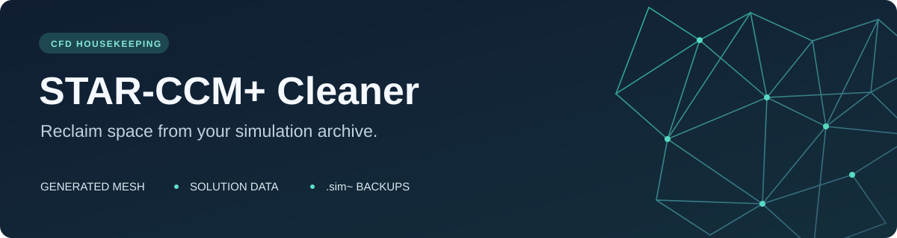
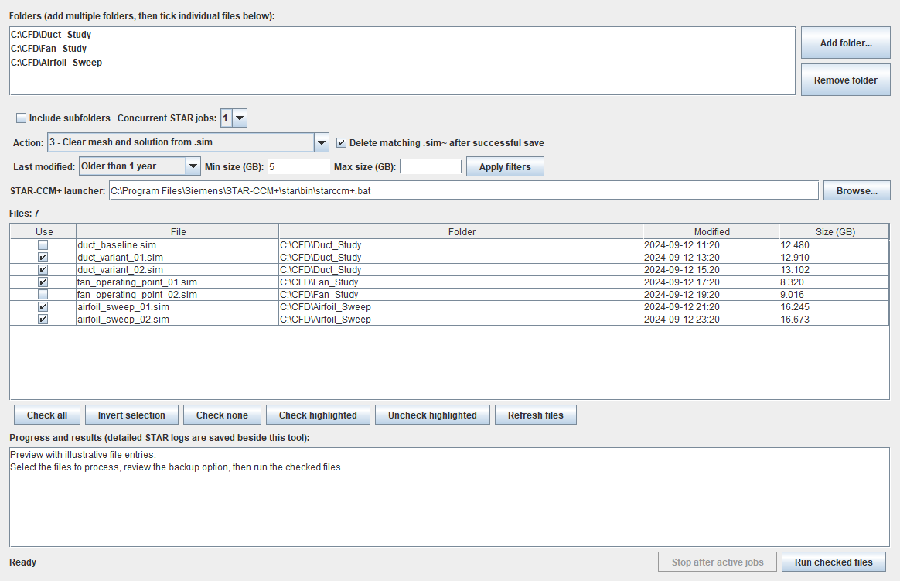

# STAR-CCM+ Cleaner



**Clear generated meshes, saved solutions, and backup files across your STAR-CCM+ projects — from one Windows window.**

[](https://github.com/notKimi/star-ccm-cleaner/actions/workflows/windows.yml)
[](https://github.com/notKimi/star-ccm-cleaner/releases/latest)
[](LICENSE)


[**Download for Windows**](https://github.com/notKimi/star-ccm-cleaner/releases/latest) · [Quick start](#quick-start) · [Troubleshooting](docs/troubleshooting.md) · [Contribute](CONTRIBUTING.md)

Finished CFD studies can leave large `.sim` files and `.sim~` backups spread across many folders. STAR-CCM+ Cleaner helps you find the files you want to trim, choose the cleanup action, and process the selection in a batch. Your simulation files stay on your machine; the app uses your installed STAR-CCM+ and writes local logs.



*App preview with illustrative file names, dates, and sizes. No simulation files are included.*

## Why use it?

- **Find the big, old files.** Scan several folders, optionally include subfolders, and filter by last modified age and minimum/maximum size in GB.
- **Choose exactly what runs.** Tick individual files, invert the checked selection, or use Shift/Ctrl to highlight rows and check or uncheck them together.
- **Keep the simulation setup.** Clear generated mesh or saved solution data while retaining geometry, mesh operations, physics, and boundary settings. Imported mesh representations are preserved.
- **Manage backups in the same workflow.** Remove the matching `.sim~` after a successful save, or select older backup files for deletion separately.
- **Control the queue.** Run 1–4 independent STAR jobs, see results and errors, and stop after the active jobs finish.

## Four cleanup actions

| Action | What it does | Needs STAR-CCM+? |
| --- | --- | --- |
| Clear generated mesh | Uses STAR's **Clear Generated Meshes** operation, then saves the `.sim` | Yes |
| Clear solution | Clears saved solution data, then saves the `.sim` | Yes |
| Clear mesh and solution | Clears both, then saves the `.sim` | Yes |
| Delete selected backups | Permanently deletes only the `.sim~` files you tick | No |

> **Before your first run:** cleanup saves over the selected `.sim` files. **Delete matching `.sim~` after successful save** is enabled by default and also removes a matching backup that already exists. Uncheck it to retain that recovery copy. Close selected simulations in other STAR sessions before running.

## Quick start

### 1. Download and extract

Get the Windows ZIP from the [latest release](https://github.com/notKimi/star-ccm-cleaner/releases/latest) and extract the entire folder. The download contains the app, macro, launcher, and documentation. Java and STAR-CCM+ are installed separately.

### 2. Set your local paths

Copy `local-env.example.bat` to `local-env.bat` beside `Start-StarCleanup.bat`. Edit the two paths in your copy:

```bat
set "STAR_CCM_EXE=C:\Path\To\starccm+.bat"
set "STAR_CCM_JAVA=C:\Path\To\javaw.exe"
```

Use the launcher from your STAR-CCM+ installation and a Java 21 runtime. A suitable JDK bundled with STAR-CCM+ can be used. Local configuration is excluded from Git and the public download.

### 3. Select and clean

Double-click `Start-StarCleanup.bat`, add your folders, choose an action, and tick the files you want to process. Review the backup option, then click **Run checked files** and confirm the selection.

Results appear in the progress area. Detailed STAR logs are saved in `logs/` beside the app. A failed job keeps its matching backup; a successful save with a backup deletion problem is reported as a warning.

## Compatibility

| Component | Requirement / verified version |
| --- | --- |
| Operating system | Windows |
| App runtime | Java 21; JDK 21 to build from source |
| STAR-CCM+ | Separately installed and licensed for mesh/solution cleanup |
| Verified STAR release | **2602.0001**, build **21.02.008-R8** |
| Other STAR releases | Not yet verified; macro API changes may require adjustments |

The app's build and backup handling tests use a fake STAR process. They do not require Siemens libraries or a license, and do not establish compatibility with additional STAR releases.

## Will concurrent jobs make cleanup faster?

They can improve throughput when several files are waiting. Each job opens a separate STAR session; this is concurrency **between files**. Start with **1** for large models, then try **2** if RAM, disk throughput, and simultaneous license capacity allow it. More jobs can be slower when they compete for the same disk. File size reduction depends on the data stored in each simulation.

**Stop after active jobs** allows running saves to finish and skips files that have not started.

## Build from source

Clone this repository, then run from PowerShell with a JDK:

```powershell
git clone https://github.com/notKimi/star-ccm-cleaner.git
cd star-ccm-cleaner
.\build.ps1 -JavaHome 'C:\Path\To\JDK'
```

The script writes the runnable app to `dist/`. Configure `dist/local-env.bat` as described above and run `dist/Start-StarCleanup.bat`. If `JAVA_HOME` is set or `javac.exe` is on `PATH`, you can omit `-JavaHome`.

See the [development guide](docs/development.md) for the project layout, tests, and ZIP packaging.

## Get help or contribute

Found an error? [Report a problem](https://github.com/notKimi/star-ccm-cleaner/issues/new/choose) with your app/STAR versions and the relevant **redacted** log lines. See [troubleshooting](docs/troubleshooting.md) for incomplete saves, unavailable mesh cleanup, and launch issues.

Contributions are welcome, especially compatibility reports for other STAR releases, clearer documentation, and focused fixes. Read [CONTRIBUTING.md](CONTRIBUTING.md) to get started. If the app saves you time, a GitHub star helps other CFD users find it.

## Author and license

Created and maintained by **Luchen Wang** ([notKimi](https://github.com/notKimi)). Copyright © 2026 Luchen Wang. Released under the [MIT License](LICENSE).

This is an independent community project. Simcenter STAR-CCM+ is a Siemens product; this project is not affiliated with or endorsed by Siemens. No Siemens binaries, licenses, or simulation data are distributed.
